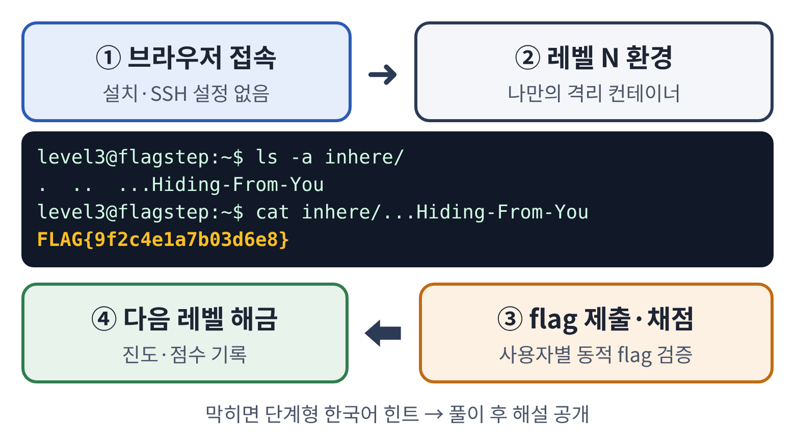
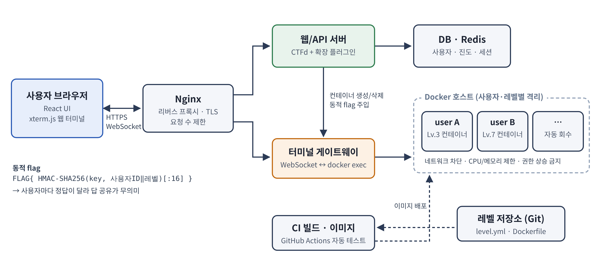

# 🚩 FlagStep

> 브라우저만 있으면 시작하는 **단계형 보안 워게임 학습 플랫폼**
> *OverTheWire Bandit 방식으로 레벨마다 숨겨진 flag를 찾아보세요.*


---

## 📌 프로젝트 소개

FlagStep은 리눅스 명령어와 보안 기초를 **단계별 문제(레벨)** 로 익히는 오픈소스 웹사이트 설계 프로젝트입니다.
기존 워게임의 불편한 점을 다음과 같이 개선합니다.

| 기존 Bandit의 문제 | FlagStep의 해결 방법 |
|---|---|
| SSH 클라이언트 설치·설정 필요 | 브라우저 **웹 터미널**(xterm.js)로 바로 접속 |
| 여러 명이 한 서버를 공유 | 사용자·레벨별 **격리 Docker 컨테이너** |
| 모두에게 같은 정답 → 답 공유 | HMAC 기반 **사용자별 동적 flag** |
| 영어 설명, 힌트 없음 | **한국어** 단계형 힌트와 해설 |

## 🧭 학습 흐름

1. 브라우저로 사이트 접속
2. 레벨 N의 나만의 컨테이너에서 flag 탐색
3. flag 제출 → 자동 채점
4. 다음 레벨 해금



## 🏗️ 시스템 구성



- **프런트엔드**: React, xterm.js
- **웹/API 서버**: CTFd + 확장 플러그인
- **터미널 게이트웨이**: WebSocket ↔ `docker exec`
- **격리 환경**: Docker (네트워크 차단, 자원 제한)

## 📁 폴더 구조

```
flagstep/
├── doc/          # 프로젝트 제안서, 그림
├── src/          # 소스 코드
│   └── flag_gen.py
├── LICENSE
└── README.md
```

## ▶️ 실행 예시

동적 flag 생성기(`src/flag_gen.py`)를 실행해 볼 수 있습니다.

```bash
python src/flag_gen.py make 20261707 3
python src/flag_gen.py check 20261707 3 "FLAG{...}"
```

## 📄 문서

- [프로젝트 제안서 (docx)](doc/오픈소스기초설계_제안서_여승우.docx)

## 🔗 참고 자료

- [OverTheWire Bandit](https://overthewire.org/wargames/bandit/)
- [CTFd](https://github.com/CTFd/CTFd)
- [xterm.js](https://xtermjs.org/)
- [Docker Engine security](https://docs.docker.com/engine/security/)

## ⚖️ 라이선스

이 프로젝트는 **[Apache License 2.0](LICENSE)** 을 따릅니다.

---

<sub>숭실대학교 오픈소스기초설계 · 11팀 · 여승우</sub>
